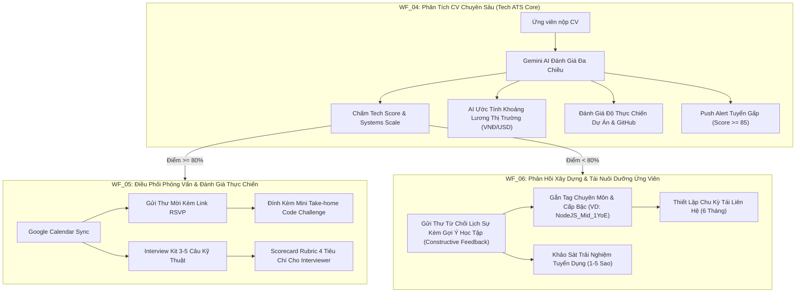

# Kế Hoạch Nâng Cấp Bộ 3 Workflow Tuyển Dụng Doanh Nghiệp (WF_04, WF_05, WF_06)

Tài liệu này tập trung nâng cấp độc quyền bộ ba quy trình Tuyển dụng & Đánh giá nhân tài cốt lõi (`WF_04`, `WF_05`, `WF_06`) theo chuẩn các hệ thống ATS hàng đầu (Greenhouse, Lever, TopCV Enterprise) áp dụng cho các doanh nghiệp công nghệ thực tế.

---

## 1. Mục Tiêu & Chuẩn Doanh Nghiệp Thực Tế

Hiện tại, WF_04, WF_05, WF_06 đã có nền tảng tốt (Deep Tech ATS, chống nhồi từ khóa, Interview Kit 3-5 câu, phân loại 4 domain Talent Pool). Tuy nhiên, trong môi trường tuyển dụng doanh nghiệp công nghệ thực chiến, các vấn đề sau vẫn là "điểm nghẽn" cần giải quyết:
1. **Lương & Định vị ứng viên:** HR không biết mức lương kỳ vọng/đề xuất phù hợp với thị trường cho ứng viên là bao nhiêu -> tốn thời gian deal lương.
2. **Thẩm định dự án thực chiến (Code/Project Impact):** CV đẹp nhưng có thể là lý thuyết suông -> cần đo lường mức độ thực chiến của các dự án trong CV và phân tích profile GitHub.
3. **Ứng viên bùng phỏng vấn (No-show) & Đánh giá thiếu chuẩn hóa:** Thiếu link xác nhận lịch tham gia (RSVP) và thiếu bộ tiêu chí chấm điểm phỏng vấn (Scorecard Rubric) cho Hiring Manager.
4. **Trải nghiệm ứng viên bị loại (Employer Branding):** Thư từ chối chung chung làm giảm uy tín nhà tuyển dụng; kho nhân tài (Talent Pool) bị lãng quên nếu không có cơ chế tự động đánh dấu chu kỳ liên hệ lại sau 6 tháng.

---

## 2. Kiến Trúc Luồng Tuyển Dụng Nâng Cấp

---

## 3. Nội Dung Nâng Cấp Chi Tiết Từng Workflow

### [WF_04] Tiếp Nhận, Phân Tích & Chấm Điểm CV Bằng AI
*File:* `n8n/workflows/WF_04_cv_parser_ai_scoring.json` (ID: `SPbqZlQMSoHpoqRx`)

1. **AI Salary Benchmark (Định vị mức lương thị trường):**
   - Dựa vào: Tech stack chính, số năm kinh nghiệm, quy mô dự án và vị trí ứng tuyển.
   - AI tính toán khoảng lương tham chiếu thị trường Việt Nam (VD: *28.000.000 - 35.000.000 VNĐ* cho Middle Backend NodeJS/NestJS/AWS).
   - Lưu vào `parsedSkillsJson.salaryBenchmark` hiển thị trực tiếp cho HR trên bảng quản trị.
2. **Thẩm định mức độ thực chiến dự án (Practical Project Impact):**
   - Đánh giá xem ứng viên có kinh nghiệm thực tế giải quyết bài toán: Chịu tải (High Concurrency), Tối ưu Database Indexing, Caching (Redis), Kiến trúc Microservices hay chỉ làm đồ án sinh viên/CRUD cơ bản.
   - Trả về điểm `practicalProjectScore` (0-100) và 1 dòng tóm tắt dự án nổi bật nhất.
3. **Phân tích GitHub / Portfolio:**
   - Nếu có GitHub URL: Nhận diện ngôn ngữ lập trình chủ đạo, cấu trúc repo cá nhân, đánh giá hoạt động đóng góp thực tế.
4. **Push Notification cho HR khi gặp ứng viên Fast Track (Điểm >= 85):**
   - Khi phát hiện CV xuất sắc, tự động kích hoạt thông báo tức thì (Webhook/Slack/Telegram) tới Trưởng bộ phận kỹ thuật để chốt lịch phỏng vấn ngay trong ngày (giảm Time-to-Hire xuống dưới 48 giờ).

---

### [WF_05] Điều Phối Lịch Phỏng Vấn & Đồng Bộ Google Calendar
*File:* `n8n/workflows/WF_05_interview_scheduler.json` (ID: `Z8f05InterviewSc`)

1. **Link RSVP Xác nhận tham gia / Yêu cầu dời lịch (Self-Service Scheduling):**
   - Trong email gửi ứng viên, tích hợp 2 nút bấm tương tác:
     - `[Xác Nhận Tham Gia]`: Tự động cập nhật `candidate.parsedSkillsJson.interviewSchedule.rsvpStatus = 'CONFIRMED'`.
     - `[Yêu Cầu Đổi Giờ]`: Mở form nhanh để ứng viên đề xuất khung giờ khác thuận tiện hơn.
2. **Bộ tiêu chí chấm điểm phỏng vấn (Interview Scorecard Rubric):**
   - Tự động sinh file / bảng tiêu chí chấm điểm chuẩn hóa cho Người phỏng vấn (Hiring Manager) gồm 4 trụ cột:
     - **Chuyên môn & Cấu trúc mã nguồn (Technical Depth):** 40% trọng số.
     - **Tư duy giải quyết vấn đề (Problem Solving):** 30% trọng số.
     - **Hiểu biết hệ thống & Vận hành (System & Scalability):** 20% trọng số.
     - **Giao tiếp & Tinh thần làm việc nhóm (Culture & Communication):** 10% trọng số.
3. **Tự động đính kèm Mini Take-home Code Challenge:**
   - Dựa trên domain ứng tuyển, tự động tạo 1 đề bài mini-coding thực tế (30-45 phút, ví dụ: Viết API phân trang kèm caching hoặc thiết kế schema database cho giỏ hàng) để ứng viên chuẩn bị góc nhìn kỹ thuật trước khi vào phỏng vấn.
4. **Kịch bản chống bùng phỏng vấn (Anti-No-Show):**
   - Tự động chuẩn bị nội dung email nhắc lịch 24 giờ trước giờ phỏng vấn kèm Google Meet link.

---

### [WF_06] Gửi Thư Từ Chối Lịch Sự & Lưu Kho Nhân Tài (Điểm < 80%)
*File:* `n8n/workflows/WF_06_rejection_notification.json` (ID: `Z8f06RejectNotif`)

1. **Thư từ chối phản hồi mang tính xây dựng (Constructive Feedback Email):**
   - Không dùng thư từ chối mẫu lạnh lùng.
   - Thư nêu rõ:
     - Lời cảm ơn chân thành và công nhận điểm sáng trong hồ sơ của ứng viên.
     - 1-2 điểm kỹ năng cần tích lũy thêm kinh nghiệm thực chiến để đáp ứng tốt hơn yêu cầu vị trí hiện tại.
     - Khẳng định hồ sơ đã được lưu vào Mạng lưới Nhân tài ưu tiên của công ty.
2. **Gắn Tag chuyên môn chi tiết & Thời hạn liên hệ lại (6-Month Re-engagement):**
   - Thay vì chỉ chia 4 domain lớn, tự động gắn tags chi tiết: `[NodeJS_Mid]`, `[React_Fresher]`, `[AWS_DevOps_Junior]`.
   - Tính toán ngày `reEngagementDate` (= ngày hiện tại + 180 ngày) lưu vào DB. Khi công ty mở đợt tuyển dụng mới, hệ thống tự động lọc ra các ứng viên tiềm năng này để mời ứng tuyển lại.
3. **Khảo sát trải nghiệm tuyển dụng (Candidate Experience - CX Survey):**
   - Đính kèm link đánh giá 1 chạm (1-5 sao) để HR liên tục cải tiến quy trình phỏng vấn và hình ảnh thương hiệu nhà tuyển dụng.

---

## 4. User Review Required (Quyết Định Cần Bạn Duyệt)

1. **Dữ liệu hiển thị trên Admin / Frontend:** Tất cả các trường dữ liệu mới (`salaryBenchmark`, `practicalProjectScore`, `scorecardRubric`, `reEngagementDate`, `rsvpStatus`) sẽ được lưu an toàn bên trong trường `parsedSkillsJson` của bảng `Candidate`. Điều này đảm bảo **100% Backward Compatible**, không làm thay đổi hay xung đột bất kỳ bảng hay tính năng nào hiện tại.
2. **Chế độ kiểm thử (Safety Test Mode):** Toàn bộ email tạo bởi WF_05 và WF_06 vẫn được cấu hình gửi về email test (`doanthanhhuy1309@gmail.com`) để bạn kiểm tra trực tiếp giao diện thư thực tế mà không lo gửi nhầm ứng viên.
3. **Phân phối thực hiện:** Nâng cấp tuần tự theo thứ tự: **WF_04 -> WF_05 -> WF_06**, sau mỗi WF sẽ chạy lệnh test thực tế và xuất kết quả nghiệm thu trước khi chuyển tiếp.

---

## 5. Kế Hoạch Nghiệm Thu (Verification Plan)

### Automated Test:
- **Test WF_04:** Gửi 1 file CV Tech thật qua webhook `POST /webhook/process-cv`.
  - Xác nhận kết quả trả về có `salaryBenchmark` (khoảng lương VNĐ), `practicalProjectScore` và các trường kỹ thuật.
  - Xác nhận DB lưu đầy đủ không bị mất dữ liệu.
- **Test WF_05:** Gửi payload ứng viên điểm cao qua webhook `POST /webhook/schedule-interview`.
  - Xác nhận nhận được email thư mời kèm link RSVP và Interview Kit 3-5 câu + Rubric chấm điểm.
- **Test WF_06:** Gửi payload ứng viên điểm thấp qua webhook `POST /webhook/rejection-notification`.
  - Xác nhận nhận được email thư từ chối có lời khuyên xây dựng (Constructive Feedback) và DB ghi nhận ngày `reEngagementDate` (180 ngày).

### Manual Verification:
- Kiểm tra trực tiếp trên giao diện n8n: Các node xử lý logic mới hiển thị trực quan, chạy trơn tru không báo đỏ.
- Kiểm tra hộp thư `doanthanhhuy1309@gmail.com`: Xem thư mời phỏng vấn và thư phản hồi định dạng HTML doanh nghiệp chuyên nghiệp.
